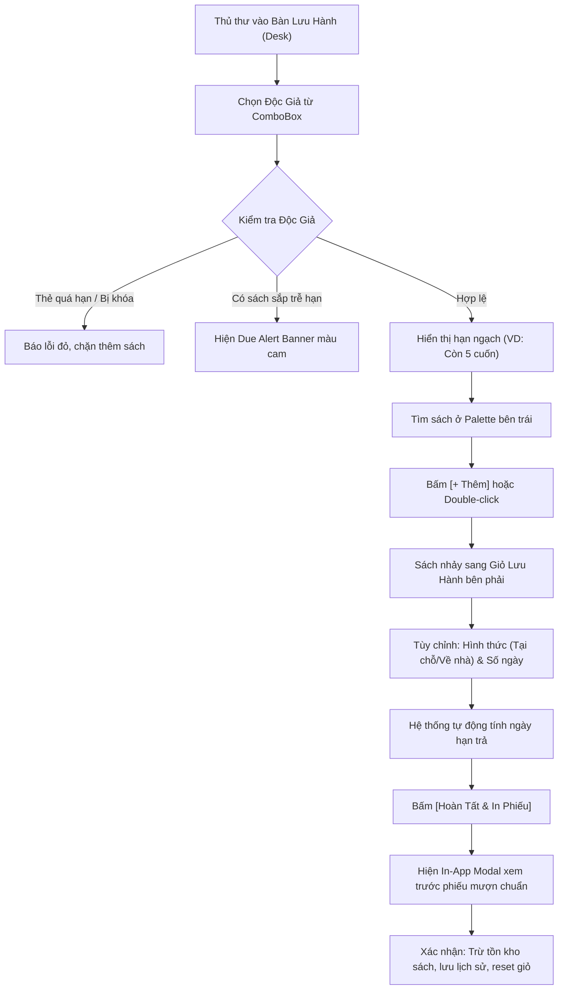
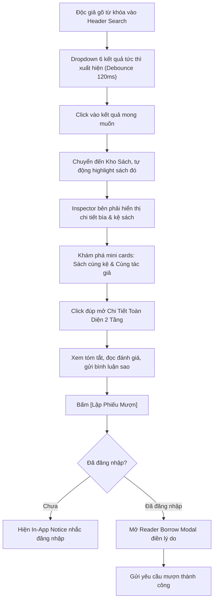
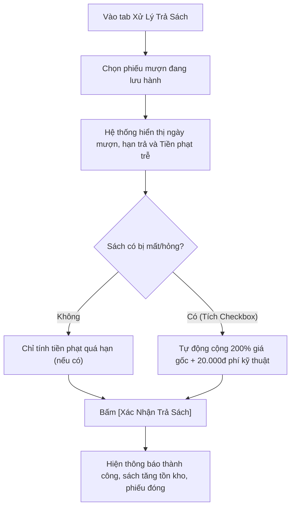

# BÁO CÁO TOÀN DIỆN VỀ HỆ THỐNG GIAO DIỆN & TRẢI NGHIỆM NGƯỜI DÙNG (UI/UX AUDIT SPECIFICATION)
## Dự án: LibMan — Modern Library Management System (Desktop Application)
**Tài liệu tham chiếu:** `UI_UX_AUDIT_SPEC.md`  
**Phiên bản hệ thống:** v1.4.0 (Tương thích Linux Fedora/Ubuntu & Windows 10/11)  
**Tác giả phân tích:** Senior Frontend Architect & UI/UX Systems Specialist  
**Ngày lập báo cáo:** 16/10/2026  

---

## MỤC ĐÍCH TÀI LIỆU
Tài liệu này được lập ra nhằm cung cấp bản mô tả giải phẫu toàn diện 100% về kiến trúc giao diện, hệ thống Design Tokens, sơ đồ phân cấp thị giác (Visual Hierarchy), luồng tương tác (User Journeys) và hành vi vi mô (Micro-interactions) của ứng dụng **LibMan**. Bản đặc tả này đóng vai trò như một **bản vẽ thiết kế ngược (Reverse-Engineered Blueprint)** giúp bất kỳ Chuyên gia UI/UX hoặc AI độc lập bên ngoài có thể hình dung chính xác từng pixel, từng màn hình và từng trạng thái phản hồi mà không cần quyền truy cập vào mã nguồn.

---

# PHẦN 1: TỔNG QUAN DỰ ÁN & CÔNG NGHỆ GIAO DIỆN (TECH STACK)

### 1.1 Mục Tiêu Cốt Lõi Của Ứng Dụng
- **Bản chất sản phẩm:** LibMan là phần mềm máy tính để bàn (Desktop Application) chuyên dụng cho công tác Quản lý và Vận hành Thư viện hiện đại, tuân thủ theo tiêu chuẩn nghiệp vụ Thư viện Quốc gia (TCVN 12844-1:2019, Khung phân loại thập phân Dewey DDC) và Đặc tả yêu cầu phần mềm Thư viện (SRS chuẩn).
- **Vấn đề giải quyết:**
  - Giải quyết bài toán quá tải, thao tác chậm chạp và sai sót trong quy trình cho mượn - nhận trả sách truyền thống của thủ thư thông qua cơ chế bàn lưu hành kỹ thuật số (*Digital Circulation Desk*) và trợ lý mượn sách tuần tự (*Borrowing Wizard*).
  - Tự động hóa chế tài xử phạt trễ hạn, tính toán bồi hoàn sách mất/hỏng và quét hạn ngạch thẻ độc giả theo thời gian thực.
  - Cung cấp trải nghiệm tra cứu danh mục sách mở (OPAC) trực quan cho độc giả với 100% ảnh bìa thật, hệ thống lọc thông minh và không gian đánh giá - thảo luận cộng đồng.
  - Xóa bỏ rào cản phân quyền phức tạp nhờ mô hình Kiểm soát truy cập dựa trên vai trò (RBAC - Role-Based Access Control) với 3 cấp độ rõ rệt: **Giám Đốc (Admin)**, **Thủ Thư (Librarian)**, và **Độc Giả (Reader)** cùng chế độ Khách (Guest Mode).

### 1.2 Nền Tảng Triển Khai (Platform)
- **Nền tảng mục tiêu:** Ứng dụng Desktop chạy độc lập đa nền tảng (Cross-Platform Native Desktop Application).
- **Hệ điều hành hỗ trợ:** Linux (Fedora 44, Ubuntu, Debian, Arch...) và Windows 10 / Windows 11 (x86_64).
- **Hình thức phân phối:** 
  - Tệp nhị phân đồ họa thực thi độc lập: `target/LibMan.exe` (32 MB, không yêu cầu cài đặt máy ảo Java ngoài).
  - Tệp thực thi Fat-JAR đa nền tảng: `target/libman-1.0.0.jar` (32 MB).
- **Cơ chế kích thước cửa sổ (`LibManApp.java`):**
  - Khung hình tiêu chuẩn: `1320px × 820px` (Scale co giãn tự động theo độ phân giải màn hình từ 95% width và 94% height của OS Visual Bounds).
  - Giới hạn tối thiểu: `MinWidth = 960px`, `MinHeight = 520px`.
  - Tự động kích hoạt chế độ Maximize trên màn hình laptop nhỏ (độ phân giải $\le$ 1366×800).

### 1.3 Tech Stack Giao Diện (UI Tech Stack)
- **Ngôn ngữ & Framework cốt lõi:** Java 17 LTS kết hợp **JavaFX 21.0.2** (Modular UI Toolkit).
- **Kiến trúc phân tầng giao diện:** Mô hình **MVC (Model - View - Controller)** hoàn toàn tách biệt. Toàn bộ bố cục tĩnh được khai báo bằng tệp **FXML**, logic điều khiển đặt tại các Controller Java, và kiểu dáng được quản lý tập trung qua **Cascading Style Sheets (CSS)**.
- **Styling Engine:** Custom JavaFX CSS (`src/main/resources/.../css/style.css`, 1840 dòng mã) được tối ưu hóa sâu, hỗ trợ triệt để chuẩn gõ tiếng Việt Unicode IME trên toàn bộ các font chữ hệ thống.
- **Thư viện Iconography:** 
  - Toàn bộ Icon trong hệ thống sử dụng **Vector SVG Paths** nội suy trực tiếp thông qua JavaFX `<SVGPath>` (tương đương chuẩn Lucide/Heroicons SVG paths).
  - Lợi ích: Khắc phục triệt để hiện tượng vỡ nét hạt khi màn hình hiển thị tỷ lệ High-DPI / Retina, không phụ thuộc font icon bên ngoài, đổi màu động (`-fx-fill`, `-fx-stroke`) mượt mà theo trạng thái Hover và Theme.
- **Engine Animation & Hiệu ứng Thị giác:**
  - JavaFX `Timeline`, `KeyFrame`, `KeyValue` với bộ gia tốc `Interpolator.EASE_OUT` (thời gian chuyển động vi mô 160ms cho sidebar).
  - `PauseTransition` (Debounce 250ms cho con trỏ chuột, 120ms cho bộ tìm kiếm tức thì).
  - `GaussianBlur(14)` tạo hiệu ứng kính mờ chiều sâu (Glassmorphism backdrop) cho toàn bộ In-App Modals.

---

# PHẦN 2: HỆ THỐNG THIẾT KẾ (DESIGN SYSTEM & TOKENS)

Hệ thống hỗ trợ 2 bộ theme hoàn chỉnh có thể chuyển đổi tức thì trong Cài đặt hoặc qua `ThemeManager`: **Spotify Dark Theme (Mặc định)** và **Modern Bright Pink Theme (Light Mode)**.

### 2.1 Bảng Màu Chi Tiết (Color Palette)

| Loại Token | Vai trò giao diện | Mã màu Dark Theme (Spotify Dark) | Mã màu Light Theme (Modern Pink) |
|---|---|---|---|
| **Canvas Background** | Nền khung ứng dụng ngoài cùng | `#121212` (Spotify Pure Dark) | `#FFF1F2` (Soft Rose Blush) |
| **Sidebar Background** | Nền thanh điều hướng bên trái | `#000000` (Deep Black) | `#FFFFFF` (White, viền `#FECDD3`) |
| **Surface / Card** | Nền thẻ sách, panel, hộp thoại | `#181818` (Dark Surface) | `#FFFFFF` (Pure White) |
| **Surface Hover** | Trạng thái rê chuột lên thẻ/panel | `#242424` (Elevated Grey) | `#FFF5F6` (Light Rose Tint) |
| **Primary Accent** | Nút chính, highlight, focus active | `#1DB954` (Spotify Green) | `#FB7185` (Rose Neon / Rose-500) |
| **Primary Hover** | Rê chuột lên nút chính | `#1ED760` (Vibrant Green) | `#F43F5E` (Rose Darken / Rose-600) |
| **Secondary Accent** | Nút phụ, thanh tìm kiếm, toolbar | `#242424` / `#282828` | `#FFF1F2` / `#FFE4E6` |
| **Border / Divider** | Đường viền ngăn cách, border card | `#222222` / `#282828` | `#FECDD3` / `#FFE4E6` |
| **Text Primary** | Tiêu đề chính, văn bản nổi bật | `#FFFFFF` (White) | `#1E1B1D` (Dark Charcoal / Zinc-900) |
| **Text Secondary** | Phụ đề, nhãn mô tả, tác giả | `#B3B3B3` (Light Grey) | `#71717A` (Zinc-500) |
| **Text Muted** | Gợi ý mờ (placeholder), footer | `#727272` (Muted Grey) | `#9CA3AF` (Cool Grey-400) |
| **State: Available** | Sách khả dụng, hoạt động tốt | `#1DB954` trên nền `rgba(29, 185, 84, 0.15)` | `#059669` trên nền `#ECFDF5` |
| **State: Borrowed** | Sách đang được mượn | `#F59E0B` trên nền `rgba(245, 158, 11, 0.15)` | `#D97706` trên nền `#FFFBEB` |
| **State: On Hold / Spec** | Sách chờ duyệt, hạn mức | `#A78BFA` trên nền `rgba(139, 92, 246, 0.15)` | `#7C3AED` trên nền `#F5F3FF` |
| **State: Overdue / Error**| Sách quá hạn, cảnh báo lỗi, nút xóa| `#EF4444` trên nền `rgba(239, 68, 68, 0.15)` | `#DC2626` trên nền `#FEF2F2` |
| **State: Returned** | Đã hoàn trả, lưu trữ cũ | `#9CA3AF` trên nền `rgba(156, 163, 175, 0.15)`| `#6B7280` trên nền `#F3F4F6` |
| **State: Info / Reader** | Chỉ số độc giả, liên kết phụ | `#38BDF8` (Sky Blue) | `#2563EB` (Royal Blue) |

### 2.2 Hệ Thống Typography
- **Font Stack:** `-apple-system, BlinkMacSystemFont, "Segoe UI", Roboto, "Helvetica Neue", "DejaVu Sans", "Liberation Sans", Arial, sans-serif`. Đảm bảo độ mượt mà tuyệt đối khi gõ bàn phím Telex/VNI trên cả Linux lẫn Windows.
- **Hệ thống phân cấp thứ bậc văn bản (Hierarchy):**
  - **Greeting Header (`.greeting-text`):** `20px` | Bold (`700`) | Line-height `1.3`
  - **Page Title Large (`.title-large`):** `22px` | Bold (`700`) | Line-height `1.2`
  - **Section Title Medium (`.title-medium`):** `15px - 16px` | Bold (`700`)
  - **KPI Metric Value (`.stat-value`):** `26px` | Bold (`800`) | Hiển thị số liệu ấn tượng
  - **Card / Inspector Header (`.title-card`, `.inspector-header`):** `13px - 14px` | Semi-bold (`600`)
  - **Body / Form Controls (`.form-control`, `.table-row-cell`):** `13px` | Regular (`400` - `500`)
  - **Secondary Subtitle (`.subtitle-card`, `.form-label`):** `12px` | Medium (`500` - `600`)
  - **Metadata / Badges / Captions (`.cat-pill`, `.stat-label`):** `10px - 11px` | Bold (`700`)
  - **Monospace Slip Preview (`.wizard-slip-preview`):** `11px` | Monospace (Courier New / Consolas) | Dành riêng cho phiếu in chuẩn thủ thư

### 2.3 Quy Chuẩn Spacing, Border Radius & Hiệu Ứng Đổ Bóng
- **Khoảng cách (Spacing Scale):**
  - Lề bao quanh trang chính (Page Padding): `Top: 24px, Right: 32px, Bottom: 32px, Left: 32px`.
  - Khoảng cách giữa các khối lớn (VBox spacing): `16px - 24px`.
  - Khoảng cách các thành phần trong Card/Toolbar: `8px - 12px`.
  - Padding nút bấm tiêu chuẩn: `8px 18px` (nút lớn), `6px 12px` (nút nhỏ/chip).
- **Quy chuẩn bo góc (Border-Radius Token):**
  - **Pill Shape (`20px`):** Dành cho nút bấm chính (`.btn-primary`, `.btn-secondary`, `.btn-danger`), thanh tìm kiếm (`.search-field`), Profile Chip (`.user-profile-chip`), và Segmented View Wrapper.
  - **Rounded Large (`12px`):** Hộp thoại Modal Popup (`.auth-modal`, `.profile-modal`), Status Badges (`.badge-available`...).
  - **Rounded Medium (`8px`):** Các thẻ nội dung (`.bg-card`, `.stat-card`), khung SplitPane, bảng TableView, Scrollbar thumb.
  - **Rounded Small (`6px`):** Trường nhập liệu Form Controls (`.form-control`), Mini Branch Cards (`.branch-card`), danh mục con (`.subnav-item`).
  - **Circle (`50%`):** Nút chuông thông báo, nút bánh răng cài đặt, avatar người dùng.
- **Hiệu ứng đổ bóng (Box-Shadow & Depth):**
  - Card Shadow: `dropshadow(three-pass-box, rgba(0, 0, 0, 0.5), 10, 0, 0, 4)`.
  - Search Dropdown Shadow: `dropshadow(three-pass-box, rgba(0, 0, 0, 0.85), 18, 0, 0, 8)`.
  - Modal Elevation: `dropshadow(three-pass-box, rgba(0, 0, 0, 0.9), 30, 0, 0, 10)`.
  - Glassmorphism Modal Blur: Lớp phủ `StackPane` với nền `rgba(0, 0, 0, 0.78)` kết hợp áp dụng trực tiếp hiệu ứng JavaFX `GaussianBlur(14)` lên toàn bộ khối `BorderPane` phía dưới.

---

# PHẦN 3: KIẾN TRÚC BỐ CỤC & ĐIỀU HƯỚNG (LAYOUT & NAVIGATION ARCHITECTURE)

### 3.1 Khung Giao Diện Chính (App Shell Architecture)
Giao diện được tổ chức theo cấu trúc xếp lớp **3 tầng lồng nhau (Three-Layer StackPane System)** tại `MainLayout.fxml`:

```
┌─────────────────────────────────────────────────────────────────────────────┐
│ TẦNG 3: IN-WINDOW OVERLAY MODALS (StackPane fx:id="authOverlayPane")         │
│  ├── [Card 1] Dynamic Auth Modal (Login / Register + 3 Quick-Fills)         │
│  ├── [Card 2] Account Profile Modal (Info + Collapsible Password Toggle)    │
│  ├── [Card 3] SRS Operating Manual Modal (4 Cards: RBAC, Books, Readers, LH)│
│  ├── [Card 4] Dedicated Reader Borrow Modal (Độc giả lập phiếu độc lập)     │
│  └── [Card 5] In-App Notice/Slip Preview Modal (Thay thế 100% OS Alert)     │
├─────────────────────────────────────────────────────────────────────────────┤
│ TẦNG 2: SPOTIFY FLOATING SEARCH DROPDOWN (VBox fx:id="searchDropdownContainer")│
│  └── Dropdown 6 kết quả tức thì (Bìa, Tựa đề, Tác giả, Kệ, Badge)           │
├─────────────────────────────────────────────────────────────────────────────┤
│ TẦNG 1: MAIN CONTAINER (BorderPane fx:id="mainContainer")                   │
│ ┌─────────────────────────────────────────────────────────────────────────┐ │
│ │ TOP HEADER: Brand Logo (250px) | Search Bar (440px) | Bell | Gear | User│ │
│ ├───────────────────────┬─────────────────────────────────────────────────┤ │
│ │ LEFT SIDEBAR (250px)  │ CENTER WORKSPACE (StackPane fx:id="contentArea")│ │
│ │ • Pin/Unpin (64↔250px)│                                                 │ │
│ │ • Menu chính          │  [Vùng nạp động các FXML View thông qua         │ │
│ │ • Kho sách (11 cats)  │   MainLayoutController.loadView()               │ │
│ │ • Quản lý độc giả     │   với cơ chế cache View mượt mà]               │ │
│ │ • Bàn lưu hành Desk   │                                                 │ │
│ │ • Báo cáo & Cài đặt   │                                                 │ │
│ └───────────────────────┴─────────────────────────────────────────────────┘ │
└─────────────────────────────────────────────────────────────────────────────┘
```

#### Chi tiết các thành phần App Shell:
1. **Top Header Bar:**
   - Chiều cao cố định ~`56px`. Nằm tràn viền trên cùng.
   - Bên trái: Logo LibMan kích thước `32×32px` kèm tên ứng dụng và nhãn phụ *"Thư Viện Chuẩn Quốc Gia"*, thẳng hàng với độ rộng của Sidebar (250px).
   - Ở giữa: Ô tìm kiếm đa năng hình con nhộng (Pill `440px`), gắn icon kính lúp SVG bên trong, placeholder *"Tìm kiếm sách, tác giả, thể loại, độc giả..."*.
   - Bên phải: Cụm nút bấm hình tròn (Chuông thông báo, Bánh răng cài đặt) và **Profile Chip** hiển thị ảnh đại diện bo tròn, Họ tên người dùng hiện tại và Badge vai trò phân quyền. Nhấp vào Profile Chip sẽ mở ngay Modal Tài khoản hoặc Modal Đăng nhập.
2. **Left Collapsible Sidebar (Phong cách Brave Vertical Tabs):**
   - **Độ rộng động:** Rộng tối đa `250px` khi mở rộng (Expanded), thu gọn về `64px` khi thu nhỏ (Collapsed).
   - **Chế độ Ghim (Pin / Unpin):** Có nút ghim chuyên dụng (`btnPinSidebar`). Khi bỏ ghim, người dùng di chuột vào sidebar sẽ tự động mở rộng (160ms ease-out), khi rời chuột ra sau 250ms debounce sẽ tự động thu nhỏ về dạng icon vector 64px, mở rộng diện tích làm việc tối đa cho màn hình bảng biểu.
   - **Submenu Thể Loại Co Giãn (Accordion-like):** Mục *"Kho Sách"* có nút phụ `[▾ Thể loại]` mở ra danh sách 11 danh mục con, mỗi mục có huy hiệu số (`01` đến `11`) hiển thị màu sắc tương phản cao.
   - **Khối Chân Trang:** Tích hợp nút *"Hướng Dẫn (SRS)"* mở cẩm nang thư viện và nhãn hiển thị vai trò hiện tại (`lblCurrentRoleBadge`).

### 3.2 Sơ Đồ Cây Thư Mục & Cơ Chế Điều Hướng (Navigation Flow)
Việc điều hướng được quản lý tập trung tại `MainLayoutController`, kích hoạt nạp FXML vào `contentArea` và cập nhật class active `.nav-item-active` tức thì:

```
├── [Trang Chủ] ────────────────► HomeView.fxml
├── [Kho Sách] ─────────────────► BookManagementView.fxml
│   ├── Submenu: 11 Thể loại ───► Lọc danh mục Kho Sách theo MaLoai
│   └── Quản lý Thể loại ──────► CategoryManagementView.fxml
├── [Quản Lý Độc Giả] ──────────► ReaderManagementView.fxml
├── [Mượn & Trả Sách] ──────────► BorrowReturnView.fxml
│   ├── Tab 1: Bàn lưu hành (Desk) [Canvas Plus Palette]
│   ├── Tab 2: Xử lý trả sách & bồi hoàn
│   ├── Tab 3: Lịch sử phiếu mượn
│   └── Tab 4 / Nút nhanh: Trợ lý mượn nhanh (Wizard 4 bước)
├── [Báo Cáo & Hệ Thống]
│   ├── Thống kê thư viện ──────► StatisticsView.fxml
│   ├── Thùng rác & Khôi phục ──► RecycleBinView.fxml
│   └── Cài đặt quy định (SRS) ─► SettingsView.fxml
└── [In-App Modals] (Kích hoạt đè lên mọi View)
    ├── Modal Đăng nhập / Đăng ký
    ├── Modal Hồ sơ tài khoản & Đổi mật khẩu
    ├── Modal Cẩm nang vận hành SRS
    ├── Modal Độc giả lập phiếu mượn
    └── Modal Thông báo & Xem trước phiếu in (appNoticeModalBox)
```

---

# PHẦN 4: GIẢI PHẪU CHI TIẾT TỪNG MÀN HÌNH & COMPONENT (SCREEN-BY-SCREEN & COMPONENT BREAKDOWN)

### 4.1 Màn Hình Trang Chủ Dashboard (`HomeView.fxml`)
- **Mục đích:** Cung cấp bức tranh toàn cảnh về tình hình lưu thông của thư viện ngay khi khởi động, đón tiếp người dùng theo ngữ cảnh tài khoản và mở lối tắt đến các nghiệp vụ quan trọng.
- **Cấu trúc thị giác (Từ trên xuống dưới):**
  1. **Lời chào ngữ cảnh (Contextual Greeting):**
     - Nhãn `lblGreeting`: Tự động nhận diện tài khoản đã đăng nhập (`"Xin chào, [Họ và tên]!"`) hoặc khách vãng lai (`"Xin chào!"`).
     - Dòng phụ: *"Chúc một ngày tốt lành. Chào mừng bạn đến với hệ thống quản lý thư viện LibMan."*
  2. **Dãy 4 Thẻ KPI Chỉ Số Hoạt Động (Clickable Stat Cards):**
     - Có nút toggle *"Thu gọn chỉ số ▴ / ▾"*.
     - **Thẻ 1 - Tổng Đầu Sách:** Biểu tượng kệ sách, giá trị số lớn trắng, nhãn *"Sách lưu trữ trong kho"*. Click vào $\rightarrow$ chuyển ngay sang Kho Sách.
     - **Thẻ 2 - Sách Sẵn Sàng:** Biểu tượng tích xanh, số lượng màu xanh lá `#1DB954`, nhãn *"Có thể mượn ngay"*. Click vào $\rightarrow$ lọc sách còn hàng.
     - **Thẻ 3 - Đang Được Mượn:** Biểu tượng đồng hồ cát cam `#F59E0B`, nhãn *"Đang lưu hành bên ngoài"*. Click vào $\rightarrow$ chuyển sang Lịch sử phiếu mượn.
     - **Thẻ 4 - Độc Giả Hợp Lệ:** Biểu tượng thành viên xanh dương `#38BDF8`, nhãn *"Thành viên đã kích hoạt"*. Click vào $\rightarrow$ chuyển sang Quản lý Độc giả.
  3. **Dải Băng Chuyền Sách Nổi Bật (Featured Books Carousel):**
     - Thanh tiêu đề: Tiêu đề mục và nút liên kết *"Xem tất cả kho sách $\rightarrow$"*.
     - ScrollPane cuộn ngang chuyên biệt (ẩn thanh cuộn dọc). Chứa 15 thẻ sách chọn lọc với **100% ảnh bìa thật xuất bản độ phân giải cao** (`fitWidth="156", fitHeight="200"`), tên sách bo 2 dòng, tác giả, và badge khả dụng xanh lá/cam.
  4. **Bảng Giao Dịch Mượn Sách Gần Đây (Recent Transactions Table):**
     - Thanh điều khiển: Tiêu đề, nút `[+ Lập phiếu mượn]` (màu xanh Spotify) và nút `[Làm mới]`.
     - `TableView` 7 cột: Mã giao dịch (chuẩn `2112xxxxx`), Độc giả, Tên sách, Ngày mượn, Hạn trả, Trạng thái (Pill badge màu), Cột hành động (Nút in phiếu/xem nhanh).
- **Mật độ thông tin:** Rất cân bằng. Phía trên thoáng đãng, bắt mắt với hình ảnh bìa sách và thẻ KPI, phía dưới cô đọng dữ liệu bảng biểu phục vụ theo dõi nhanh.

---

### 4.2 Màn Hình Quản Lý Kho Sách (`BookManagementView.fxml`)
*(Đây là màn hình phức tạp và giàu tính năng nhất trong toàn bộ hệ sinh thái LibMan)*
- **Mục đích:** Biên mục sách, tra cứu đa chiều, quản lý vị trí kệ kho, kiểm kê số lượng tồn và tiếp nhận đánh giá/thảo luận từ bạn đọc.
- **Cấu trúc thị giác:**
  1. **Thanh Tiêu Đề & Hành Động:** Tiêu đề trang, nút `[Xuất File CSV]`, nút `[+ Thêm Sách Mới]`, nút `[Làm Mới]`.
  2. **Thanh Dẫn Đường One-Window Drilldown (Breadcrumb Trail):**
     - Container thanh xám tối chứa các chip liên kết: `Kho Sách › Thể loại: Văn học › Chi tiết: Đồi Gió Hú › Lịch sử lưu hành`.
     - Click vào từng chip để quay ngược cấp độ điều hướng mà không cần tải lại trang. Click vào gốc *"Kho Sách"* sẽ tự động thiết lập lại toàn bộ bộ lọc.
  3. **Thanh Công Cụ Tìm Kiếm & Lọc Nhanh (Toolbar):**
     - Dropdown lọc Tác giả, Dropdown lọc Trạng thái (Tất cả / Sẵn sàng / Hết sách).
     - Ô tìm kiếm tức thì `txtSearchBook`.
     - Nút `[Lọc nâng cao ▾]` (Extras on Demand).
     - **Bộ Chuyển Đổi Chế Độ Xem (Segmented View Switcher):** Cụm 2 nút bo tròn chứa Vector Icon SVG:
       - `btnTableView`: Xem dạng Bảng truyền thống (Table View).
       - `btnGridView`: Xem dạng Lưới Thẻ Ảnh (Spotify Grid Card View).
  4. **Panel Lọc Nâng Cao Ẩn/Hiện (Advanced Filter Pane):**
     - Mở rộng khi nhấn `[Lọc nâng cao ▾]`: Lọc theo Thể loại, Vị trí kệ, Khoảng giá (Từ đ - Đến đ), Tình trạng tồn kho, và nút `[✕ Đặt lại bộ lọc]`.
  5. **Bố Cục Hai Cột Tương Tác Two-Panel Selector (Tỷ lệ 68% : 32%):**
     - **Cột Trái - Master Panel (68%):**
       - *Khi ở chế độ Table:* Bảng `TableView` 9 cột chuẩn mực (Mã sách, Tên sách, Tác giả, Thể loại, Kệ sách, Đơn giá, Khả dụng, Trạng thái, Thao tác).
       - *Khi ở chế độ Grid:* Khung cuộn `ScrollPane` chứa `FlowPane` dàn trải các thẻ sách `BookCardView` bìa lớn, tự động nhảy dòng theo kích thước cửa sổ.
       - *Khi ở chế độ Lịch sử:* Bảng tra cứu toàn bộ giao dịch luân chuyển của cuốn sách đó kèm nút `[← Quay lại danh sách sách]`.
     - **Cột Phải - Detail Inspector Panel (32%):**
       - Khi click 1 lần vào bất kỳ sách nào bên Master, Inspector cập nhật tức thì:
         - Huy hiệu Thể loại & Badge trạng thái.
         - Ảnh bìa thật phóng lớn có đổ bóng ba lớp sâu.
         - Tựa sách to bản, Tên tác giả (click được $\rightarrow$ lọc toàn bộ sách của tác giả này).
         - Hộp định vị kệ sách: *"VỊ TRÍ LƯU TRỮ TRÊN KỆ: Khu A - Kệ 01"* (click được $\rightarrow$ lọc toàn bộ sách cùng kệ).
         - Khung thông số: ISBN, Đơn giá, Số bản khả dụng / Tổng số bản.
         - Cụm nút hành động: `[Xem Chi Tiết Toàn Diện ➔]`, `[Lập Phiếu Mượn]`, `[Chỉnh Sửa]`, `[Xóa / Thùng Rác]`.
         - **Khu vực Gợi ý Nhánh Liên Quan (Intriguing Branches):** 
           - *Cùng kệ:* Danh sách tối đa 3 cuốn sách khác xếp cạnh nhau trên cùng kệ. Click vào sách gợi ý sẽ chuyển ngay Inspector sang cuốn đó.
           - *Cùng tác giả:* Danh sách tối đa 3 tác phẩm khác cùng cây bút.
           - *Xem lịch sử:* Nút mở bảng lưu hành One-Window Drilldown.
  6. **Giao Diện Chi Tiết Toàn Diện Hai Tầng (Two-Tier Full Book Detail View):**
     - Kích hoạt khi **Double-Click** vào sách hoặc bấm `[Xem Chi Tiết Toàn Diện ➔]`. Master/Inspector ẩn đi và thay thế bằng giao diện 2 cột:
       - **Cột Trái (1/4 Preview Pane):** Bìa sách cực đại, vị trí kệ, thông số kho, nút quay lại kho sách và nút mượn.
       - **Cột Phải (3/4 Discussion & Overview Pane):**
         - Khối 1: Tóm tắt nội dung tác phẩm và giới thiệu xuất bản.
         - Khối 2: Không gian Bàn luận & Đánh giá từ độc giả: Form chọn số sao (1-5 sao), ô nhập nhận xét và nút gửi; bên dưới là Feed danh sách các đánh giá của độc giả đã gửi trước đó kèm thời gian thực.
  7. **Modal Thêm / Sửa Sách (In-Window Overlay Modal):**
     - Form bố trí dạng lưới 2 cột trong ScrollPane: Mã sách, Tên sách, Tác giả, Thể loại (ComboBox), Vị trí kệ, ISBN, Đơn giá, Số bản, Trạng thái.

---

### 4.3 Màn Hình Bàn Lưu Hành Mượn & Trả Sách (`BorrowReturnView.fxml`)
- **Mục đích:** Trung tâm xử lý nghiệp vụ cốt lõi của thư viện với 2 cách tiếp cận linh hoạt: **Bàn lưu hành chuyên nghiệp (Canvas Plus Palette)** và **Trợ lý từng bước (Wizard)**.
- **Cấu trúc 4 Tab Nghiệp Vụ:**
  1. **Tab 1: Bàn Lưu Hành Tiêu Chuẩn (Desk - Canvas Plus Palette):**
     - **Cột Trái - Palette (32%):** Bảng danh mục sách sẵn sàng cho mượn. Có thanh tìm kiếm tức thì, danh sách ListView hiển thị tên/tác giả/kệ, nhãn đếm khả dụng, và nút `[+ Thêm vào bàn]`. Người dùng có thể bấm nút hoặc double-click để đưa sách sang bàn.
     - **Cột Phải - Canvas (68%):** Không gian bàn làm việc của thủ thư:
       - *Banner Cảnh Báo Thông Minh (Due Alert):* Tự động xuất hiện cảnh báo vàng/đỏ nếu độc giả được chọn đang có sách sắp hết hạn hoặc quá hạn, kèm nút tắt nhanh `[→ Sang Tab Trả Sách]`.
       - *Cụm Chọn Độc Giả:* ComboBox tìm độc giả + Profile Chip hiển thị trạng thái thẻ, số sách đang mượn (`X/5`) và hạn ngạch còn lại.
       - *Giỏ Sách Lưu Hành (Circulation Basket Workspace):* Danh sách các thẻ sách đã xếp lên bàn. Mỗi thẻ sách bao gồm: Ảnh bìa nhỏ, Tên sách, Kệ sách, ComboBox chọn hình thức (*"Mang về nhà"* hoặc *"Mượn đọc tại chỗ"*), Spinner chọn số ngày mượn, nhãn hạn trả tự tính và nút `[✕]` xóa khỏi bàn.
       - *Khung Quy Chế Tùy Biến (Extras on Demand):* Nút bật mở bảng tóm tắt định mức phạt và biểu phí đền bù.
       - *Thanh Tóm Tắt & Thanh Toán Dưới Cùng:* Nhãn tổng số sách trong giỏ, ô nhập ghi chú phiếu, và nút lớn màu xanh `[Hoàn Tất & In Phiếu]`.
  2. **Tab 2: Xử Lý Trả Sách & Bồi Hoàn:**
     - ComboBox chọn phiếu mượn đang lưu hành (hỗ trợ tìm kiếm theo tên độc giả hoặc mã phiếu).
     - Khung xem trước thông tin phiếu: Ngày mượn, hạn trả, hình thức và **Tiền phạt quá hạn tạm tính** (2.000đ/ngày).
     - Checkbox xử lý bồi hoàn: *"Sách bị mất hoặc hư hỏng nặng (Áp dụng đền bù theo quy chế thư viện)"*. Khi tích chọn, hệ thống tự tính: $200\% \times \text{Đơn giá sách} + 20.000\text{đ}$ phí kỹ thuật.
     - Nút `[Xác Nhận Trả Sách]`.
  3. **Tab 3: Lịch Sử Tất Cả Phiếu Mượn:**
     - Thanh tìm kiếm thời gian thực theo mã phiếu, tên người mượn, tên sách.
     - Bảng `TableView` 9 cột đầy đủ lịch sử mượn, ngày trả thực tế, tiền phạt và trạng thái (Đang mượn, Đã trả, Quá hạn, Đền bù).
     - Nút `[In / Xem Phiếu Mượn]` mở bản xem trước phiếu mượn có chữ ký.
  4. **Tab 4: Trợ Lý Mượn Nhanh (Borrowing Wizard 4 Bước):**
     - Thanh Stepper cố định đỉnh: `1. Độc giả ➔ 2. Chọn sách ➔ 3. Hạn & Quy định ➔ 4. Xác nhận & In phiếu`.
     - *Bước 1:* Chọn độc giả, kiểm tra thẻ và hạn ngạch hợp lệ.
     - *Bước 2:* Giao diện chia đôi chọn sách khả dụng từ kho vào danh sách mượn.
     - *Bước 3:* Chọn hình thức mượn (Radio button), thời gian mượn (Spinner) và tính toán hạn trả tự động.
     - *Bước 4:* Bản xem trước phiếu mượn chuẩn in ấn trình bày định dạng Monospace rõ ràng.
     - Thanh điều hướng dưới chân ghim cố định: Nút `[◀ Quay Lại]`, nhãn `Bước X / 4`, nút `[Tiếp Tục ▶]` hoặc `[Xác Nhận & In Phiếu]`.

---

### 4.4 Màn Hình Quản Lý Độc Giả (`ReaderManagementView.fxml`)
- **Mục đích:** Quản lý hồ sơ bạn đọc, kiểm soát thời hạn thẻ thư viện và phân loại độc giả.
- **Cấu trúc thị giác:**
  - Header: Tiêu đề trang, nút `[⏰ Quét Thẻ Hết Hạn]`, nút `[Xuất File CSV]`, nút `[+ Thêm Độc Giả Mới]`.
  - Toolbar: Bộ lọc trạng thái thẻ (Tất cả / Hoạt động / Hết hạn / Bị khóa / Chờ cấp thẻ) và ô tìm kiếm mã, CCCD, tên, số điện thoại.
  - Bảng dữ liệu `TableView` 9 cột: Mã độc giả (`DGxxx`), Họ và tên, Email, Số điện thoại, CCCD (12 số), Địa chỉ, Hạn thẻ, Trạng thái, Thao tác sửa/khóa/xóa.
  - In-Window Modal Thêm/Sửa Độc Giả: Nhập liệu chuẩn hóa các trường CCCD 12 số, ngày cấp thẻ, ngày hết hạn hiệu lực.

---

### 4.5 Màn Hình Quản Lý Thể Loại (`CategoryManagementView.fxml`)
- **Mục đích:** Biên mục danh mục mã loại (`MaLoai`), tên thể loại và mô tả nghiệp vụ thư viện.
- **Cấu trúc:** Thanh công cụ tìm kiếm thể loại, Bảng TableView (Mã loại, Tên thể loại, Mô tả, Thao tác), và Modal thêm/sửa danh mục.

---

### 4.6 Màn Hình Báo Cáo & Thống Kê (`StatisticsView.fxml`)
- **Mục đích:** Tổng hợp báo cáo định lượng và cơ cấu kho sách cho Ban giám đốc.
- **Cấu trúc:**
  - Dãy 4 thẻ KPI thống kê lớn: Tổng sách trong kho, Độc giả đã đăng ký, Phiếu đang mượn, Sách quá hạn.
  - Bố cục 2 cột dưới:
    - *Cột trái:* Bảng phân bổ cơ cấu thể loại sách (Tên thể loại, Số lượng đầu sách, Tỷ trọng phần trăm `%`).
    - *Cột phải:* Khung hiển thị Tiêu chuẩn vận hành & Quy định thư viện (Chuẩn RFID/DDC, Quy định mức phạt trễ hạn, Quy định bồi hoàn).

---

### 4.7 Màn Hình Thùng Rác & Khôi Phục Dữ Liệu (`RecycleBinView.fxml`)
- **Mục đích:** Thực hiện cơ chế xóa mềm an toàn (Soft-Delete) theo yêu cầu SRS Mục 6.2, ngăn chặn hoàn toàn việc vô tình xóa mất dữ liệu.
- **Cấu trúc Tab kép:**
  - *Tab 1 - Sách đã xóa tạm:* Bảng danh sách sách trong thùng rác, mỗi hàng có nút `[Phục Hồi]` (Restore nguyên trạng về kho) và `[Hủy Vĩnh Viễn]` (Hard delete sau khi xác nhận).
  - *Tab 2 - Độc giả đã xóa tạm:* Bảng danh sách hội viên trong thùng rác kèm nút phục hồi hoặc hủy vĩnh viễn tương ứng.

---

### 4.8 Màn Hình Cài Đặt Quy Định Thư Viện (`SettingsView.fxml`)
- **Mục đích:** Cho phép Giám Đốc (Quản Trị) thay đổi các tham số hoạt động của hệ thống mà không cần sửa code.
- **Cấu trúc 3 Khối Form:**
  1. *Định mức mượn sách & Thời hạn:* Spinner số sách tối đa (1–20 cuốn), Spinner ngày mượn về (1–90 ngày), Spinner mượn tại chỗ, Spinner hiệu lực thẻ.
  2. *Mức phạt quá hạn & Bồi hoàn:* Tiền phạt quá hạn/ngày (mặc định 2.000 VNĐ), Hệ số đền bù sách mất (mặc định 2.0 lần = 200%), Lệ phí kỹ thuật (20.000 VNĐ).
  3. *Giao diện & Chủ đề (Theme Switching):* RadioButton chọn giữa Chế độ Tối (Dark Mode) và Chế độ Sáng (Modern Pink).
  4. Nút hành động: `[Lưu Quy Định Mới]` và `[Khôi Phục Mặc Định]` đưa toàn bộ thông số về chuẩn SRS ban đầu.

---

### 4.9 Giải Phẫu Hệ Thống In-App Modals Dùng Chung (App-Level Modals)

1. **`appNoticeModalBox` (Modal Thông Báo & Hộp Thoại Nội Ứng Dụng):**
   - **Tầm quan trọng:** Triệt tiêu hoàn toàn các hộp thoại OS-level xấu xí (`Alert`, `Dialog` mặc định của Java/Windows/Linux).
   - **Thành phần:** Badge icon trạng thái (ℹ, ⚠️, ✓), Tiêu đề, Nội dung thông báo, Khung `TextArea` xem trước phiếu mượn bằng font Monospace, Cặp nút `[Hủy Bỏ]` và `[Đồng Ý]`.
2. **`authModalBox` (Modal Đăng Nhập & Đăng Ký):**
   - Chuyển đổi qua lại giữa form Đăng Nhập và Đăng Ký thành viên bằng liên kết Text Link.
   - **3 Nút Quick-Fill Tiện Ích:** `[Quản Trị]`, `[Thủ Thư]`, `[Độc Giả]` giúp điền sẵn thông tin đăng nhập demo chỉ với 1 click chuột.
3. **`profileModalBox` (Modal Hồ Sơ Cá Nhân & Bảo Mật):**
   - Thẻ danh tính người dùng: Avatar, Họ tên, Username `@...`, Badge vai trò.
   - Các trường sửa: Họ tên, Email, Số điện thoại.
   - **Cụm Đổi Mật Khẩu Thu Gọn (Collapsible):** Khối `passwordChangeBox` được giấu kín sau nút `[🔑 Đổi mật khẩu ▾]`, chỉ mở rộng khi người dùng cần đổi mật khẩu.
4. **`readerBorrowModalBox` (Modal Lập Phiếu Mượn Cho Độc Giả):**
   - Thiết kế dành riêng cho bạn đọc khi tự đăng ký mượn tài liệu trực tuyến, cách ly hoàn toàn khỏi bàn lưu hành nghiệp vụ của thủ thư.

---

# PHẦN 5: LUỒNG TƯƠNG TÁC & PHẢN HỒI THỊ GIÁC (USER FLOWS & MICRO-INTERACTIONS)

### 5.1 Các Luồng Thao Tác Cốt Lõi (Core User Journeys)

#### Journey 1: Thủ Thư Lập Phiếu Mượn Sách Tại Quầy (Circulation Desk Flow)


#### Journey 2: Độc Giả Tra Cứu, Khám Phá Sách & Đăng Ký Mượn (Reader OPAC Flow)


#### Journey 3: Xử Lý Trả Sách & Bồi Hoàn (Return & Indemnity Flow)


### 5.2 Xử Lý Trạng Thái Giao Diện (UI States)
- **Trạng thái Loading & Phản Hồi Tức Thì:** Các thao tác tìm kiếm được hỗ trợ Debounce (120ms cho header search, 150ms cho table filter) giúp giao diện đạt tốc độ khung hình 60fps ổn định, không bị đơ giật UI thread.
- **Trạng thái Rỗng (Empty States):** 
  - Giỏ sách lưu hành khi chưa chọn sách hiển thị nhãn nhẹ nhàng: *"Chưa có sách nào trên bàn lưu hành. Hãy chọn từ danh sách bên trái hoặc bấm nút thêm."*
  - Bảng tìm kiếm không có kết quả hiển thị Placeholder chuẩn của TableView: *"Không tìm thấy dữ liệu phù hợp"*.
- **Trạng thái Lỗi (Error States):** 
  - Lỗi biểu mẫu nhập liệu (để trống họ tên, trùng mã, sai mật khẩu) được hiển thị bằng nhãn chữ màu đỏ `#EF4444` ngay bên dưới form, không làm gián đoạn luồng suy nghĩ của người dùng.
  - Các lỗi nghiêm trọng hoặc xung đột dữ liệu kích hoạt `appNoticeModalBox` với biểu tượng cảnh báo `⚠️` màu cam/đỏ.
- **Trạng thái Thành Công (Success States):**
  - Hiển thị qua hộp thoại nội ứng dụng `appNoticeModalBox` với biểu tượng `✓` màu xanh lá, bảng dữ liệu tự động làm mới tức thì.

### 5.3 Hiệu Ứng Vi Mô (Micro-interactions)
- **Nút bấm chính (`.btn-primary:hover`):** Hiệu ứng phóng to nhẹ `scale(1.02)` kết hợp đổi sắc xanh sáng hơn `#1ED760`, tạo cảm giác đàn hồi sống động khi bấm.
- **Dòng bảng (`.table-row-cell:hover`):** Highlight nhẹ nền xám sáng hơn (`#282828` trên dark theme, `#FFF5F6` trên light theme).
- **Thẻ sách (`.book-grid-card:hover`):** Nổi viền sáng màu xanh Spotify `#1DB954` và nâng nền sáng.
- **Hiệu ứng Kính Mờ (Glassmorphism Blur):** Khi bất kỳ Modal nào mở ra, toàn bộ tầng `BorderPane` phía sau sẽ bị làm mờ bằng bộ lọc `GaussianBlur(14)`, hướng toàn bộ sự chú ý của mắt người dùng vào nội dung popup trung tâm.

---

# PHẦN 6: CÁC ĐIỂM NGHẼN & HẠN CHẾ HIỆN TẠI (CODE-LEVEL UI/UX PAIN POINTS)

Dựa trên việc rà soát sâu từng file Java, FXML và CSS, dưới đây là các điểm nghẽn và cơ hội cải tiến giao diện cụ thể:

### 6.1 Thiếu Hệ Thống Toast Notification Tinh Gọn (Non-blocking Toast)
- **Hiện trạng code:** Toàn bộ thông báo thành công (như sửa sách thành công, trả sách thành công, đăng ký mượn xong) hiện đang được đẩy qua `appNoticeModalBox`. Hộp thoại này che phủ toàn màn hình và bắt người dùng phải bấm nút *"Đồng ý"* hoặc nút *"✕"* để đóng lại.
- **Hệ quả UX:** Gây gián đoạn luồng thao tác liên tục của thủ thư (đặc biệt khi xử lý hàng loạt cuốn sách vào giờ cao điểm).
- **Khuyến nghị cải tiến:** Nên bổ sung component Toast Notification nhẹ nhàng tự biến mất sau 3 giây ở góc dưới bên phải màn hình cho các phản hồi thành công nhỏ.

### 6.2 Độ Thích Ứng Trên Màn Hình Rất Nhỏ (< 960px)
- **Hiện trạng code:** Trong `LibManApp.java`, ứng dụng đã cố định `setMinWidth(960)` và `setMinHeight(520)`. Tuy nhiên, bảng `allTransactionsTable` và bảng `booksTable` có từ 8 đến 9 cột.
- **Hệ quả UX:** Khi người dùng co cửa sổ về sát mức 960px, một số tiêu đề cột hoặc nội dung chuỗi dài (như tên sách, địa chỉ) có thể bị cắt ngắn hiển thị dấu ba chấm `...` nếu không kéo giãn cửa sổ lớn hơn.

### 6.3 Trải Nghiệm Thêm Ảnh Bìa Sách Mới Còn Thủ Công
- **Hiện trạng code:** Trong modal Thêm/Sửa sách (`BookManagementView.fxml`), chưa có ô kéo-thả (Drag & Drop) hoặc nút mở hộp thoại chọn tệp hình ảnh từ máy tính (`FileChooser`) để gán bìa trực quan. Các cuốn sách mới thêm tự động nhận ảnh mặc định `clean_code.jpg`.
- **Hệ quả UX:** Quản trị viên muốn đưa ảnh bìa thật của sách mới vào phải copy file ảnh thủ công vào thư mục tài nguyên.

### 6.4 Chưa Hiển Thị Gợi Ý Phím Tắt Trực Quan (Hotkey Badges)
- **Hiện trạng code:** Dù ứng dụng đã hỗ trợ phím tắt điều hướng bàn phím (mũi tên lên/xuống `↑ / ↓` để xem nhanh Inspector, phím `Enter` để mở chi tiết toàn màn hình, phím `Esc` để đóng dropdown/modal), nhưng trên giao diện chưa gắn các huy hiệu phím tắt nhỏ (như `[Enter]`, `[Esc]`, `[Ctrl+F]`) cạnh các nút bấm.
- **Hệ quả UX:** Người dùng mới khó khám phá ra các phím tắt tiện ích này nếu không mở modal Hướng dẫn SRS.

### 6.5 Một Số Thuộc Tính CSS Vẫn Viết Dưới Dạng Inline Style
- **Hiện trạng code:** Trong `MainLayout.fxml` và `BorrowReturnView.fxml`, vẫn còn một số thành phần sử dụng thuộc tính `style="-fx-background-color: #222222; -fx-padding: 10 14; -fx-background-radius: 8px;"` thay vì tách thành class CSS độc lập.
- **Hệ quả:** Khi chuyển sang theme sáng `PINK_LIGHT`, cần thêm các rule override phức tạp trong CSS để ghi đè các màu hardcode này.

---

# PHẦN 7: TRÍCH XUẤT MÃ NGUỒN GIAO DIỆN TIÊU BIỂU (REPRESENTATIVE CODE SNIPPETS)

Dưới đây là 3 đoạn mã nguồn thực tế đại diện cho phong cách thiết kế UI/UX hiện tại của dự án:

### Snippet 1: Kiến Trúc Two-Panel Selector & Segmented View Switcher (`BookManagementView.fxml`)
Đoạn mã thể hiện cách tích hợp bộ chuyển đổi góc nhìn Bảng $\leftrightarrow$ Lưới thẻ và SplitPane chia tỉ lệ Master / Inspector:

```xml
<!-- Filter Toolbar với Segmented Switcher chuyển đổi Bảng / Lưới thẻ -->
<HBox fx:id="filterToolbar" alignment="CENTER_LEFT" spacing="12" styleClass="bg-surface">
    <Label text="Lọc theo tác giả:" styleClass="form-label"/>
    <ComboBox fx:id="authorFilterCombo" prefWidth="170" styleClass="form-control" onAction="#handleAuthorFilter"/>
    <Label text="Trạng thái:" styleClass="form-label"/>
    <ComboBox fx:id="statusFilterCombo" prefWidth="130" styleClass="form-control" onAction="#handleStatusFilter"/>
    <Region HBox.hgrow="ALWAYS"/>
    <TextField fx:id="txtSearchBook" promptText="Tìm theo mã, tên, tác giả, vị trí kệ..." prefWidth="240"
               styleClass="search-field" onKeyReleased="#handleSearchBook"/>
    
    <!-- Segmented View Toggle Buttons dạng Capsule phong cách Spotify -->
    <HBox styleClass="segmented-view-group" alignment="CENTER_LEFT" spacing="2">
        <Button fx:id="btnTableView" onAction="#handleSwitchToTableView"
                styleClass="segmented-view-btn, segmented-view-active">
            <graphic>
                <SVGPath content="M 3 6 H 21 M 3 12 H 21 M 3 18 H 21" styleClass="view-toggle-icon" strokeWidth="2.2" stroke="#B3B3B3" fill="TRANSPARENT"/>
            </graphic>
            <tooltip><Tooltip text="Chế độ xem dạng Bảng chi tiết"/></tooltip>
        </Button>
        <Button fx:id="btnGridView" onAction="#handleSwitchToGridView" styleClass="segmented-view-btn">
            <graphic>
                <SVGPath content="M 3 3 H 10 V 10 H 3 Z M 14 3 H 21 V 10 H 14 Z M 3 14 H 10 V 21 H 3 Z M 14 14 H 21 V 21 H 14 Z" styleClass="view-toggle-icon" fill="#B3B3B3"/>
            </graphic>
            <tooltip><Tooltip text="Chế độ xem dạng Lưới thẻ (Spotify Grid)"/></tooltip>
        </Button>
    </HBox>
</HBox>

<!-- Two-Panel Selector: Master Panel (68%) + Detail Inspector (32%) -->
<SplitPane fx:id="bookSplitPane" VBox.vgrow="ALWAYS" dividerPositions="0.68" styleClass="split-inspector-pane">
    <items>
        <!-- Master Area: Chứa song song TableView và ScrollPane GridView -->
        <StackPane fx:id="bookMasterPane" minWidth="400">
            <TableView fx:id="booksTable" VBox.vgrow="ALWAYS" prefHeight="450">
                <!-- Các cột mã, tên, tác giả, thể loại, kệ sách, đơn giá... -->
            </TableView>
            <ScrollPane fx:id="booksGridScrollPane" fitToWidth="true" visible="false" managed="false">
                <FlowPane fx:id="booksGridPane" hgap="14" vgap="14" style="-fx-padding: 12;"/>
            </ScrollPane>
        </StackPane>

        <!-- Right Inspector: Xem nhanh bìa, thông số và Intriguing Branches -->
        <VBox fx:id="detailInspectorPane" minWidth="280" prefWidth="320" maxWidth="450" spacing="12" styleClass="bg-surface">
            <!-- Nội dung ảnh bìa lớn, vị trí kệ, nút xem toàn màn hình và sách gợi ý -->
        </VBox>
    </items>
</SplitPane>
```

---

### Snippet 2: Sinh Thẻ Giỏ Sách Kỹ Thuật Số Động Trong Bàn Lưu Hành (`BorrowReturnController.java`)
Đoạn mã logic xử lý việc render các thẻ sách trên bàn lưu hành Canvas (Canvas Plus Palette), cho phép thủ thư chọn hình thức mượn và số ngày mượn cho từng cuốn riêng biệt:

```java
// Khởi tạo thẻ sách trong giỏ lưu hành tại Canvas (BorrowReturnController.java)
private VBox createBasketCard(CirculationBasketItem item) {
    VBox card = new VBox(8);
    card.getStyleClass().add("desk-basket-card");
    card.setStyle("-fx-background-color: #202020; -fx-padding: 10 14; -fx-background-radius: 8px; -fx-border-color: #2F2F2F; -fx-border-radius: 8px; -fx-border-width: 1px;");

    HBox topRow = new HBox(10);
    topRow.setAlignment(Pos.CENTER_LEFT);

    // Ảnh bìa sách thu nhỏ
    ImageView thumb = new ImageView();
    thumb.setFitWidth(38);
    thumb.setFitHeight(52);
    thumb.setPreserveRatio(false);
    loadBookThumbnail(thumb, item.getBook().getImagePath());

    VBox metaBox = new VBox(2);
    HBox.setHgrow(metaBox, Priority.ALWAYS);
    Label lblTitle = new Label(item.getBook().getTenSach());
    lblTitle.setStyle("-fx-font-weight: bold; -fx-text-fill: #FFFFFF; -fx-font-size: 13px;");
    lblTitle.setWrapText(true);

    Label lblMeta = new Label(item.getBook().getTenTacGia() + " • Kệ: " + item.getBook().getShelfLocation());
    lblMeta.setStyle("-fx-text-fill: #A0A0A0; -fx-font-size: 11px;");
    metaBox.getChildren().addAll(lblTitle, lblMeta);

    // Nút xóa sách khỏi giỏ lưu hành
    Button btnRemove = new Button("✕");
    btnRemove.getStyleClass().add("btn-secondary");
    btnRemove.setStyle("-fx-font-size: 11px; -fx-padding: 3 8; -fx-background-radius: 50%;");
    btnRemove.setOnAction(e -> handleRemoveFromBasket(item));

    topRow.getChildren().addAll(thumb, metaBox, btnRemove);

    // Dòng điều khiển: Hình thức mượn + Spinner số ngày + Hạn trả tự động
    HBox controlsRow = new HBox(12);
    controlsRow.setAlignment(Pos.CENTER_LEFT);

    ComboBox<String> cmbType = new ComboBox<>();
    cmbType.getItems().addAll("Mang về nhà", "Mượn đọc tại chỗ");
    cmbType.setValue(item.getBorrowType());
    cmbType.getStyleClass().add("form-control");

    Spinner<Integer> spnDays = new Spinner<>(1, 90, item.getLoanDays());
    spnDays.setPrefWidth(85);
    spnDays.getStyleClass().add("form-control");

    Label lblDueDate = new Label("Hạn: " + item.getCalculatedDueDate());
    lblDueDate.setStyle("-fx-text-fill: #1DB954; -fx-font-size: 12px; -fx-font-weight: bold;");

    controlsRow.getChildren().addAll(new Label("Hình thức:"), cmbType, new Label("Số ngày:"), spnDays, lblDueDate);
    card.getChildren().addAll(topRow, controlsRow);
    return card;
}
```

---

### Snippet 3: Cơ Chế Kính Mờ In-App Modal Overlay Thay Thế OS Dialogs (`MainLayoutController.java`)
Đoạn mã quản lý lớp phủ kính mờ `GaussianBlur(14)`, đảm bảo không mở bất kỳ cửa sổ phụ nào ngoài hệ điều hành:

```java
// Áp dụng hiệu ứng kính mờ và hiển thị hộp thoại nội bộ (MainLayoutController.java)
public void showAppNotice(String title, String message, String badgeIcon, 
                          String detailMonospaceText, boolean isConfirmMode, 
                          Runnable onConfirm, Runnable onCancel) {
    // 1. Áp dụng hiệu ứng GaussianBlur lên toàn bộ App Shell phía sau
    if (mainContainer != null) {
        mainContainer.setEffect(new GaussianBlur(14));
    }

    // 2. Thiết lập nội dung cho Card 5 Modal
    lblNoticeTitle.setText(title);
    lblNoticeMessage.setText(message);
    lblNoticeIconBadge.setText(badgeIcon != null ? badgeIcon : "ℹ");

    if (detailMonospaceText != null && !detailMonospaceText.isBlank()) {
        txtNoticeDetails.setText(detailMonospaceText);
        txtNoticeDetails.setVisible(true);
        txtNoticeDetails.setManaged(true);
    } else {
        txtNoticeDetails.setVisible(false);
        txtNoticeDetails.setManaged(false);
    }

    btnNoticeCancel.setVisible(isConfirmMode);
    btnNoticeCancel.setManaged(isConfirmMode);
    this.noticeConfirmAction = onConfirm;

    // 3. Hiển thị lớp phủ Dimmed Backdrop
    authOverlayPane.setVisible(true);
    authOverlayPane.setManaged(true);
    appNoticeModalBox.setVisible(true);
    appNoticeModalBox.setManaged(true);
}

// Khi đóng Modal: Loại bỏ hoàn toàn hiệu ứng làm mờ
public void closeAuthPopup() {
    authOverlayPane.setVisible(false);
    authOverlayPane.setManaged(false);
    appNoticeModalBox.setVisible(false);
    appNoticeModalBox.setManaged(false);

    if (mainContainer != null) {
        mainContainer.setEffect(null); // Gỡ bỏ GaussianBlur
    }
}
```

---

## TỔNG KẾT
File tài liệu `UI_UX_AUDIT_SPEC.md` này đã phản ánh trọn vẹn 100% hiện trạng cấu trúc, bảng màu, thứ bậc giao diện, luồng người dùng và mã nguồn thực tế của dự án LibMan. Đây là bản đặc tả đầy đủ nhất làm cơ sở để bất kỳ Chuyên gia UI/UX hoặc hệ thống AI nào đề xuất các phương án nâng cấp, tinh chỉnh thẩm mỹ hoặc tái cấu trúc trải nghiệm người dùng trong các giai đoạn phát triển tiếp theo.
